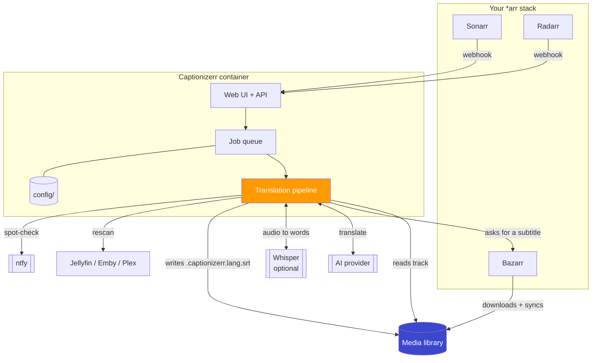
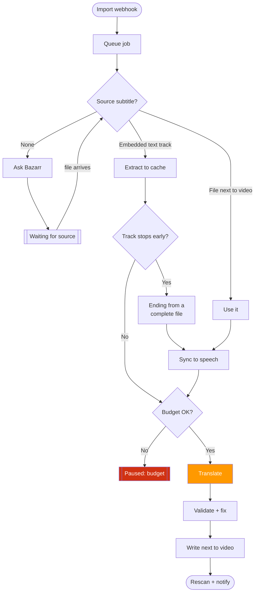
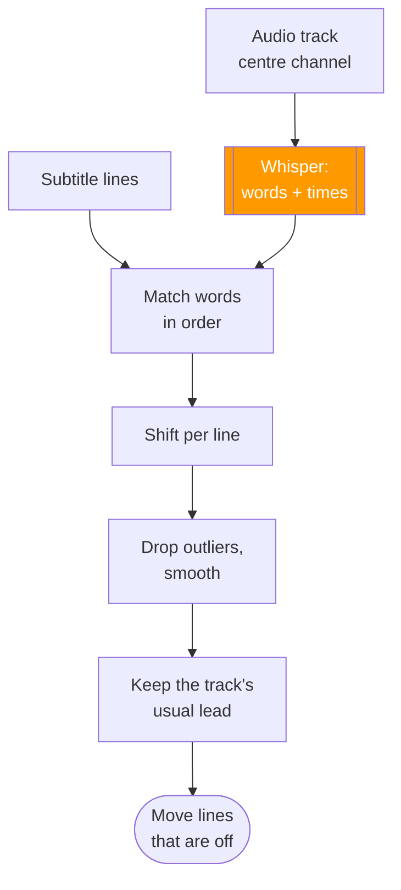
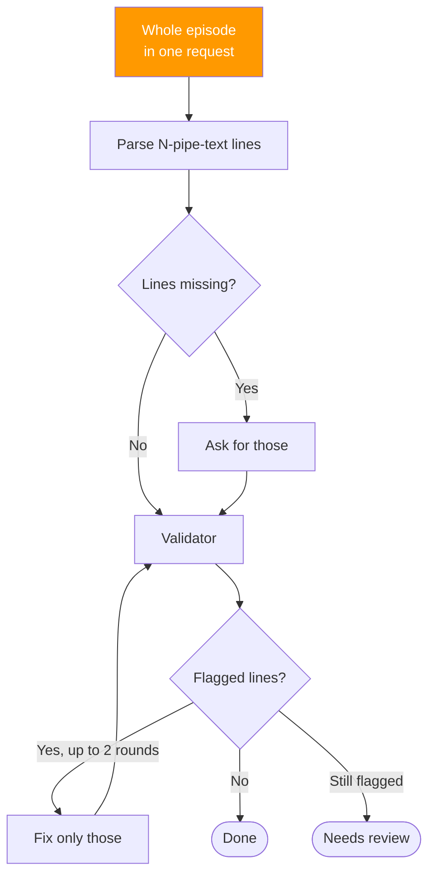
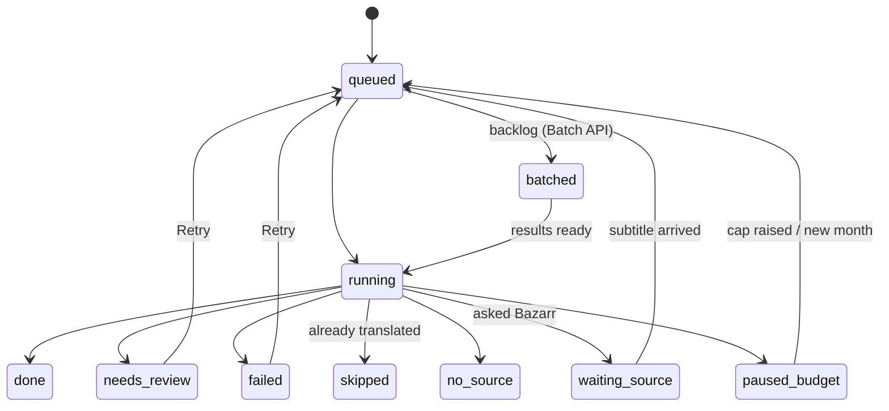
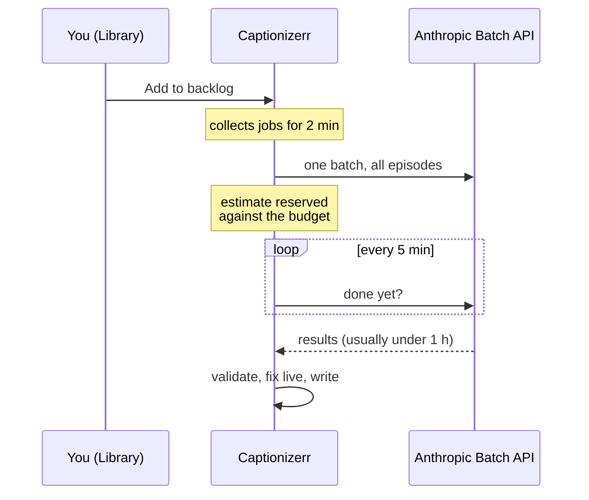
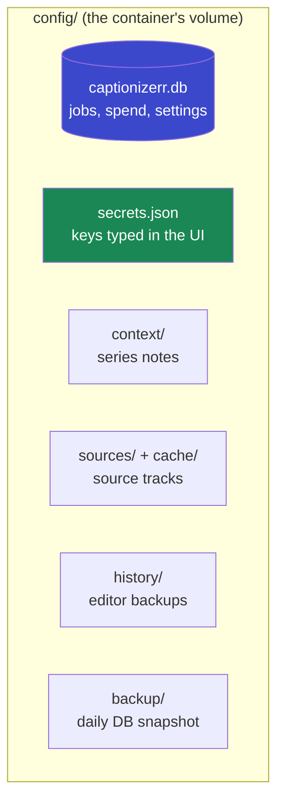
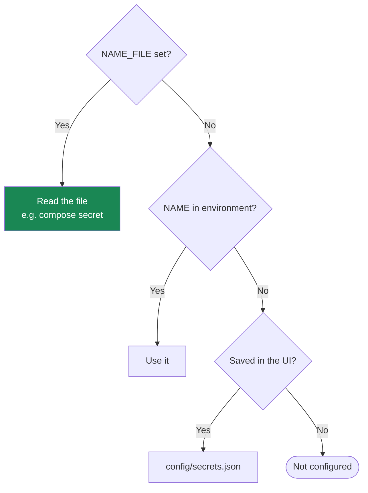
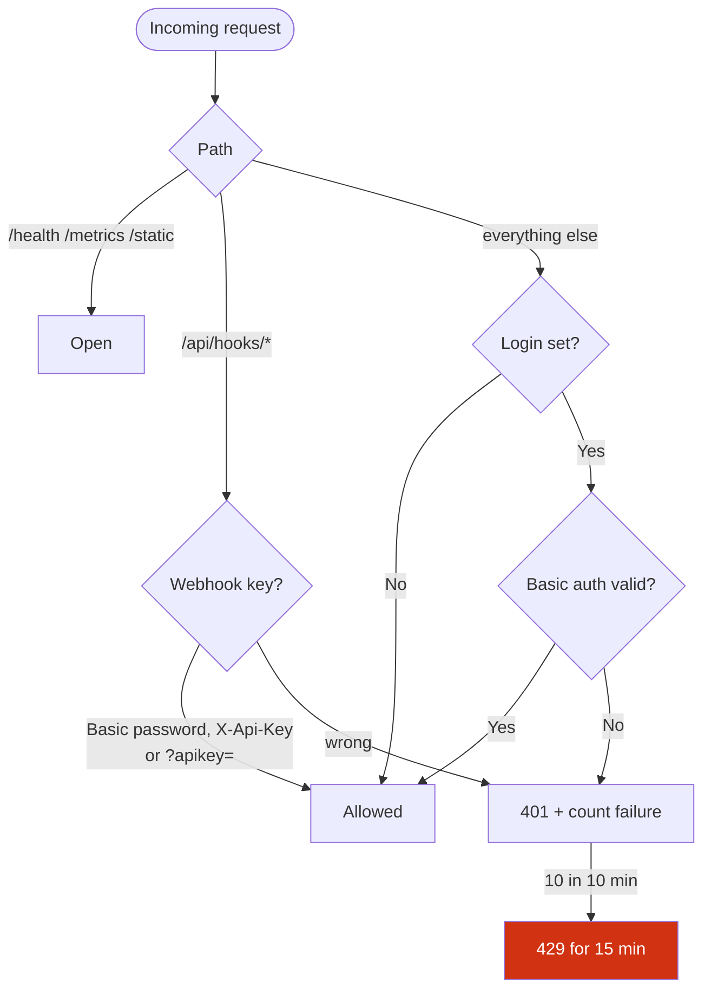

# How Captionizerr works

This page covers the parts, a job's life from import to subtitle, and where data and secrets live. For setup, see the [setup guide](setup-guide.md).

## The big picture

- **Sonarr/Radarr** call a webhook on every import, upgrade and rename. The web UI's Library can also queue anything already on disk.
- **The pipeline** reads the subtitle track that ships with the video. Only if there is none, or it stops early, does it ask **Bazarr** to fetch one.
- **Whisper** (optional) turns the audio into words with timestamps, so subtitle timing can be checked against what is actually said.
- **The only thing written into your library** is `<video>.captionizerr.<lang>.srt|ass` (plus `.forced.` for forced tracks), next to the video.
- **Media servers** are told to rescan that one folder, so the track appears within seconds.

## One job, start to finish

"Sync to speech" runs only with a Whisper service connected; without one, those sources are used with their own timing.

### Source tracks that stop early

Some releases ship a subtitle track that ends minutes before the video does, with its last line stretched over the rest (seen on WEB-DL CC tracks). A track counts as cut off when its last line lasts over a minute and runs to the end of the video, or when the last quarter of the video has no lines. Then:

1. A complete subtitle in the same language next to the video is used for the **missing ending only**: the embedded track keeps its exact timing up to where it stops. If there is none, Bazarr is asked for one and the job waits up to 3 hours.
2. The ending is lined up with the embedded track on the lines both share in the 5 minutes before the cut (shift and stretch, so a file made for 25 fps fits a 23.976 fps video).
3. With Whisper, the ending is then moved onto the speech, because a file from another release can be edited differently right after the cut, which no subtitle comparison can see.
4. If nothing usable arrives, the job translates what there is, shortens the stretched line and goes to **Needs review**, saying where the source stops.

### Sync to speech

- **Word by word.** Each line's words are found in order in the transcript, so music and effects don't throw it off the way audio-energy methods do.
- **Careful with repeats.** A line counts only when its matched words sit together in the transcript; a phrase repeated from a neighbouring line can't set its time. A line matched far from its neighbours is ignored.
- **The track's own habit is kept.** Most tracks show a line a fraction of a second before it is said; that habit (within −0.6 to +0.3 s) is measured and kept, and lines less than 0.5 s off are not touched, so a well-timed track is left alone and only the parts that are noticeably off move.
- **Where it runs:** by default (`SPEECH_SYNC=auto`) endings taken from another file and downloaded subtitles before translating; `all` adds built-in tracks, `off` leaves only **Re-sync to speech** on a translation's page, which re-times the existing file without re-translating (free; the old timing stays in the editor's history).
- **The service:** any whisper-asr-webservice-compatible server. `deploy/whisper` has a small faster-whisper one; on a 4-core laptop CPU an episode takes a few minutes.

### Inside "Translate" and "Validate + fix"

- **One request per episode.** The model sees every scene, so it knows who speaks to whom. That gives correct gender and formal or informal address, consistent names, and jokes carried through.
- **Prompt caching.** The style rules and the series notes are cached, so later episodes of a series pay little for them.
- **What the validator checks:** reading speed (short lines may run faster rather than lose words), line length and count, untranslated leftovers, merged or shifted lines, lost positioning tags and italics, and leftover speaker labels. Only flagged lines go back to the model.
- **Upgrades are re-timed, not re-translated.** When a better release replaces a file, the previous translation, including your edits, is matched line by line onto the new release. Only new or changed lines are sent to the model.

## Job states

"In progress" on the dashboard covers queued, running, batched and waiting for a source. "Needs attention" covers needs review, failed, no source and paused.

## Backlog at half price

## Where things live

**To back up:** everything in `config/` except `cache/`, `tmp/` and the live `captionizerr.db*` files. The daily snapshot in `backup/` is the consistent copy of the database. Details: [configuration](configuration.md#files-in-config).

## Where secrets come from

- **Server-provided secrets win.** A secret from a file or the environment shows as "Set on the server" in the UI and can't be changed or removed there.
- **UI secrets are write-only.** They are stored with mode 600, never in the database, and never displayed again. The one exception is **Show key** for a webhook key the UI generated itself, so it can be pasted into Sonarr or Radarr by hand.
- **The UI password** is stored as a salted PBKDF2 hash.
- **Never displayed anywhere:** keys don't appear in logs, the HTTP access log (off), API responses or the settings object's `repr`.

## Request authentication

State-changing UI requests must also come from Captionizerr's own pages (Origin/Referer check), which blocks cross-site requests from other browser tabs.
