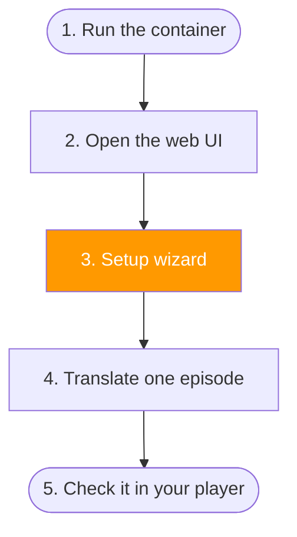
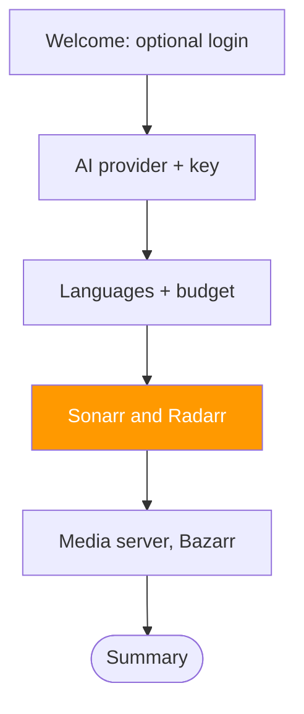

# Setup guide

From nothing to automatic subtitles in about ten minutes. You need Docker, Sonarr and/or Radarr, and either an Anthropic API key or a local Ollama server.



## 1. Run the container

```bash
mkdir captionizerr && cd captionizerr
curl -LO https://raw.githubusercontent.com/captionizerr/captionizerr/main/deploy/docker-compose.yml
```

In `docker-compose.yml`, change `/path/to/media` to your media folder. Mount it **at the same path Sonarr and Radarr see**, so the paths in their webhooks resolve inside Captionizerr too. If that isn't possible, set the path maps later in **Settings → Connections**.

```bash
docker compose up -d
docker compose logs -f captionizerr      # "Uvicorn running on http://0.0.0.0:8095"
```

The image runs as **uid 1000**. It needs write access to the media folders, because the translation is written next to each video. It needs read access to everything else in them.

## 2. Open the web UI

Open `http://<docker-host>:8095`. A fresh install opens the setup wizard automatically.

## 3. Setup wizard



| Step | What to enter | Where to find it |
|---|---|---|
| Welcome | A password, if anyone else can reach the page | Your choice; at least 8 characters |
| AI provider | **Anthropic:** the API key, then **Test key** (free). **Ollama:** the address, then **Find models**. **OpenAI-compatible:** base URL, key and model. | [console.anthropic.com](https://console.anthropic.com/) → API keys |
| Languages | The languages to translate into, e.g. `de` or `ru, uk`, and a monthly budget | Translations pause at the cap |
| Sonarr / Radarr | Address and API key → **Save** → **Test** → **Set up webhook** | In each app: Settings → General → API Key |
| Media server | Jellyfin/Emby address + API key, or Plex address + token; Bazarr (optional) | Jellyfin: Dashboard → API Keys. Plex: [token guide](https://support.plex.tv/articles/204059436). Bazarr: Settings → General |

**Set up webhook** creates a webhook called *Captionizerr* inside Sonarr or Radarr. It fires on import, upgrade and rename, and authenticates with Captionizerr's webhook key. The app then sends its test event, and you should see "✓ … its test event reached Captionizerr".

Everything here can be changed later under **Settings**.

## 4. Translate one episode

**Library** → open a series → tick an episode → **Translate selected**. The dashboard shows it under *In progress*. A 45-minute episode takes 2–5 minutes with Anthropic and about $0.30 with Opus.

Untranslated back catalogue: tick many episodes and choose **Add to backlog (½ price)**. They go out as one Batch API request, and results usually arrive within the hour (always within 24 h).

## 5. Check it in your player

The new track is listed as **"captionizerr - <Language>"** (Jellyfin). Open the episode again in **Library** to edit lines: ↻ re-translates one line, optionally with an instruction such as "more casual".

Each job's page (click its title on the dashboard) also has:
- **Re-translate**, to run the whole episode again, e.g. after switching model. It replaces the file; the old version stays in the editor's history.
- **Download**, to save the file under its own name.
- **Share…**, to upload it to OpenSubtitles.
- **Re-sync to speech** (with Whisper connected), to fix the timing of the existing file against what is actually said. Nothing is re-translated and it costs nothing; the old timing stays in the editor's history.

## Optional: sync to speech (Whisper)

Subtitles from the video or from Bazarr are sometimes off: a downloaded file made for another release drifts, or a track stops early and its ending has to come from elsewhere. A Whisper speech-to-text service lets CaptionizeRR check the timing against the audio itself.

1. Run a Whisper server on a machine with a few CPU cores (it doesn't need a GPU). The small one in [`deploy/whisper`](../deploy/whisper/README.md) installs on Debian with one script; any [whisper-asr-webservice](https://github.com/ahmetoner/whisper-asr-webservice) server works too.
2. In **Settings → Connections → Whisper**, enter its address (e.g. `http://192.0.2.30:9000`) and press **Test**.

From then on, downloaded subtitles and endings taken from another file are moved onto the speech before translating, and each translation gets **Re-sync to speech**. An episode takes a few minutes of the Whisper machine's time.

## Optional: keep secrets out of the app

Keys typed in the UI are stored in `config/secrets.json` (mode 600). To keep them out of the app's data entirely, which suits automated deploys:
- give them as files, using compose `secrets:` and `*_FILE` variables; or
- give them as environment variables.

Both take precedence and show as "Set on the server". See the commented block in `deploy/docker-compose.yml` and [configuration](configuration.md).

## Troubleshooting

| Symptom | Likely cause | Fix |
|---|---|---|
| **Test** for Sonarr says "can't reach it" | Wrong address, or the container can't resolve the hostname | Use the IP (`http://192.168.x.y:8989`) or put both containers on one Docker network |
| **Set up webhook** succeeds, but imports aren't translated | Sonarr reaches Captionizerr on a different address than your browser | Set **Settings → Security → This page's address** to one Sonarr can reach, then **Re-create webhook** |
| Job ends in **No source** | The video has only image subtitles (PGS/VobSub) and Bazarr isn't set up, or found nothing | Connect Bazarr; check that its language profile can download English |
| Job **Skipped** | A Captionizerr translation already exists; imports never overwrite it | Edit it, or press **Re-translate** on the job's page |
| Job **Needs review**: "incomplete source … stops at 50:41" | The video's subtitle track ends early and no complete one was found | Connect Bazarr (it is asked for one automatically), or put a complete subtitle next to the video, then **Re-translate** |
| Subtitles run early or late | The source subtitle was timed for another release | Connect Whisper and press **Re-sync to speech** on the job's page |
| Job fails: "can't read the video" | The file couldn't be opened, often a network-share hiccup | Check the mount on the CaptionizeRR host, then **Retry** |
| Job **Paused (budget)** | The monthly cap was reached | Raise it in **Settings → General**, then **Resume** on the dashboard |
| Track doesn't show in the player | The media server rescan isn't configured, or the paths differ | Add the media server in **Connections**; set its path map under *Different paths in the media server?* |
| "too many failed logins" (429) | 10 wrong passwords/keys within 10 minutes | Wait 15 minutes; behind a reverse proxy everyone shares one address |

Still stuck? [Open an issue](https://github.com/captionizerr/captionizerr/issues) with the job's detail line and `docker compose logs` (remove keys first).
